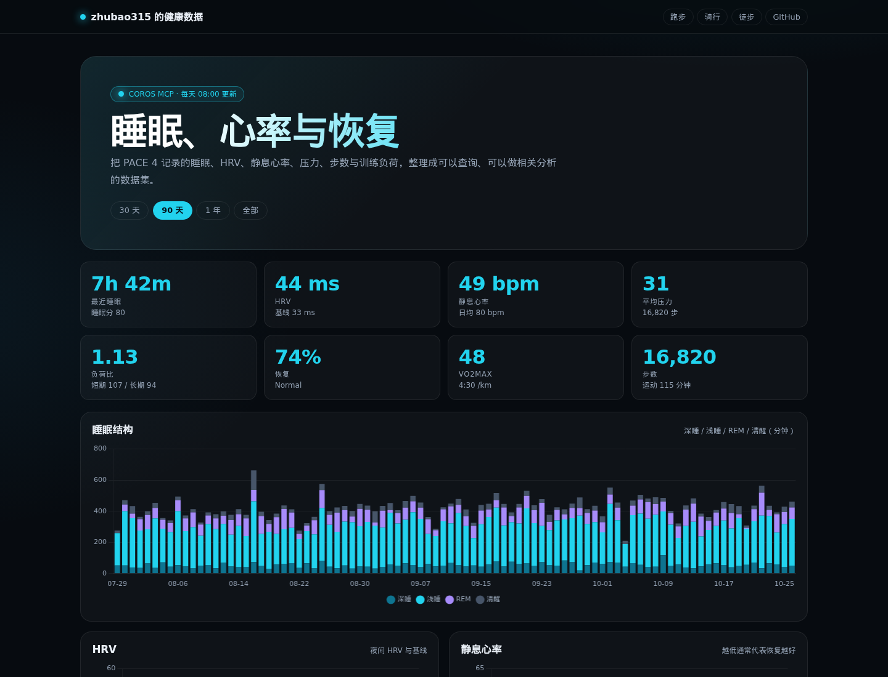
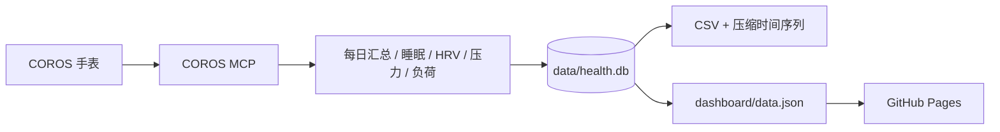

<div align="center">



# zhubao315 的健康数据

**睡眠、HRV、静息心率、压力、步数与训练负荷 —— 全部落成可查询的数据。**

[](https://github.com/zhubao315/health/actions/workflows/health_sync.yml)
[](https://zhubao315.github.io/health/)
[](https://github.com/zhubao315/health/tree/main/data)
[](https://github.com/zhubao315/health/commits)
[](https://github.com/zhubao315/health/blob/main/LICENSE)

[📊 在线面板](https://zhubao315.github.io/health/) · [🧠 分析指南](analysis/README.md) · [🔄 自动同步](#自动同步) · [🗂 数据字典](#数据字典) · [🔗 运动站点](#运动站点)

</div>

---

## 这是什么

一个纯数据仓库：每天从 **COROS 官方 MCP** 同步手表记录的健康数据，落成 SQLite + CSV + 压缩时间序列，并提供：

- 一个可直接看的 **健康趋势面板**（睡眠结构、HRV、静息心率、压力、步数、训练负荷、相关性）
- 一个 **SQL / Python 分析入口**，不用再手动导出表格
- 每天 **08:00（北京时间）** 自动更新，历史数据持续累积

## 数据覆盖

<!-- STATS:START -->
| 数据表 | 行数 | 开始 | 结束 |
| --- | ---: | --- | --- |
| 每日健康汇总 | 1,024 | 2023-12-30 | 2026-10-27 |
| 睡眠 | 1,029 | 2024-01-01 | 2026-10-28 |
| HRV | 1,012 | 2024-01-01 | 2026-10-27 |
| 日均心率 | 1,022 | 2024-01-01 | 2026-10-27 |
| 静息心率 | 1,021 | 2024-01-01 | 2026-10-27 |
| 压力（日） | 366 | 2025-10-27 | 2026-10-27 |
| 训练负荷 | 1,032 | 2024-01-01 | 2026-10-28 |
| 运动记录 | 3,262 | 2024-01-02 | 2026-10-27 |
<!-- STATS:END -->

> 最新数据：**2026-10-28** · 每天早上 08:00（北京时间）自动同步。

## 面板内容

- **数据状态**：每张图的最新数据日期、同步时间、断档/缺失提示（数据过期或缺数据一眼可见，绝不把"没数据"渲染成 0）
- **今日指标**：KPI 每项都标注自己的数据日期；7 天 / 28 天 / 选定范围均可切
- **趋势与基线**：睡眠结构（深/浅/REM/清醒 + 总时长线）、HRV（夜间值 + 28 天个人基线 + 相对基线偏差）、静息心率 / 压力 / 步数、365 天/全史日历热力图
- **训练与恢复**：短期负荷、长期负荷、负荷比（负荷比与负荷绝对量分开画，不共用纵轴）；近 90 天运动记录联动日期详情
- **相关性与洞察**：滞后相关散点（皮尔逊 r + Fisher 95 % CI + 有效对数 n + lag 切换）、六周摘要与假设
- **数据质量与原始记录**：11 个指标的缺失率、断档区间、可疑伪零、稳健异常值索引；完整逐日数据表 + CSV 导出
- 所有图表都由 `dashboard/data.json` 驱动，统计定义与 CSV/SQLite/`analysis/summary.md` 完全同源（`coros_health/db.py` + `coros_health/metrics.py`）

## 自动同步



- **调度**：每天两次（`08:00` 与 `20:00` 北京时间）。早上同步，晚上自动补跑一次——早上失败不会拖到第二天。
- **增量**：每次回看 7 天（日期重叠防漏），按表分别记录同步水位
- **失败不推进水位**：某张表拉取失败时，该表的同步水位保持原值，下次从缺口起点重新拉；`last_sync` 只在所有表都成功时推进
- **重拉不覆盖历史**：写入采用 `COALESCE(excluded, stored)` 的 upsert——新值为空时保留库中已有值，重拉缺失字段不会把历史数据抹成 NULL
- **历史**：完整回填到 2023-12-30（COROS 健康数据起点）；断档（如 2024-04-18~28）为 COROS 侧真实缺失，如实记录不插值
- **新鲜度检查**：发布后再跑一步数据鲜度校验（不阻塞发布）；拉取失败会让 Actions 变红提醒，`stale`（设备未佩戴）只给警告
- **工作流**：[`health_sync.yml`](.github/workflows/health_sync.yml)
- **无需服务器**：数据与面板都在仓库里，Pages 直接部署
- **错峰同步**：健康 08:00 / 跑步 08:10 / 骑行 08:20 / 徒步 08:30（北京时间），避免四个仓库同时登录 COROS 触发限流

## 数据字典

### 文件 / 表

| 文件 / 表 | 内容 |
| --- | --- |
| `data/daily.csv` | 每日总表（`daily` 视图导出）：步数、卡路里、运动分钟、压力、睡眠时长/分数、深睡/浅睡/REM/清醒、睡眠心率、HRV、静息心率、日均心率、训练负荷 |
| `data/daily_health.csv` | MCP 每日健康原始汇总（含睡眠分期分钟数与睡眠心率） |
| `data/sleep.csv` | 睡眠分数、主睡眠时长（分钟）、各阶段**占比**（%）、清醒时长/次数、睡眠窗口（`HH:MM`）、午睡 |
| `data/hrv.csv` | 夜间 HRV 平均值（ms）、正常区间、设备基线、评估状态 |
| `data/avg_hr.csv` | 日均心率 + 当日最低/最高（bpm） |
| `data/rhr.csv` | 每日静息心率（bpm） |
| `data/stress_daily.csv` | 日平均压力（0–100 型分值）+ 放松/低/中/高压力时长（分钟） |
| `data/load.csv` | 短期负荷、长期负荷（无量纲），负荷比（ratio），COROS 评语 |
| `data/activities.csv` | 所有运动记录（运动类型、距离 km、时长 min、均心率 bpm、卡路里） |
| `data/hrv_series.csv.gz` | 睡眠期间原始 HRV 点（约 2 分钟一个点，最近 90 天起累积） |
| `data/stress_series.csv.gz` | 原始压力序列（约 5 分钟一个点，最近 90 天起累积） |
| `data/health.db` | 以上数据的 SQLite 版本，带 `daily` 视图；`snapshots` 表每日一行（`date` 主键、幂等），设备仅存 name/model |
| `dashboard/data.json` | 面板数据（由 DB 生成） |
| `dashboard/data_quality.json` | 数据质量审计（每次同步重算） |

### 日期语义（看数据前必读）

- **睡眠、HRV 的日期 = 醒来日**：D 日夜里的睡眠/HRV 记在 D+1 那一行。`sleep.csv` 的睡眠窗口 `window_start`（通常 22–23 点开场）属于**前一晚**。
- **步数 / 压力 / 负荷 / 静息心率 / 日均心率 = 北京时间自然日**。
- **面板点击的某一天**=该日期所在的自然日 + 它记录的"醒来睡眠"；滞后相关已按此对齐（如"压力 → 当晚睡眠"实际是 D 自然日压力 vs D+1 醒来日睡眠，`lag=+1d`）。
- 时间戳时区：UTC 存储，展示按北京时间 +8；`*_series.csv.gz` 的 `timezone` 字段是 COROS 的分钟偏移（480 = UTC+8）。

### 单位

| 字段 | 单位 |
| --- | --- |
| 睡眠时长 / 分期分钟 / 清醒 / 午睡 / 压力区间时长 | 分钟（min） |
| HRV | 毫秒（ms） |
| HRV 偏差（面板「相对基线」） | ms，正 = 高于个人 28 天基线 |
| 静息心率 / 日均心率 / 睡眠心率 | 次分比（bpm） |
| 压力 | 0–100 分值 |
| 睡眠分期占比 | %（sleep 表）；面板分期图用分钟 |
| 负荷 / 负荷比 | 无量纲（COROS 算法分值） |
| 距离 | km |
| 卡路里 | kcal |

### 计算口径（单一来源 `coros_health/metrics.py` + `coros_health/db.py`）

| 派生指标 | 定义 |
| --- | --- |
| 7 天滚动均值/中位数 | trailing、日期对齐；窗内有效值 <5 → NULL |
| 28 天个人基线 | trailing 28 天均值；窗内有效值 <20 → NULL |
| 睡眠规律性 | 1 − MAD(入睡时刻, 7 天窗) / 120 min，入睡时刻按 ±12 h 环绕 |
| HRV 偏差 | 当日 HRV − 28 天 trailing 基线（ms）；与设备自带 `hrv_baseline` 是两个数、并存不下结论 |
| RHR 周趋势 | 28 天窗内 7 天均值的前半 vs 后半差值（bpm/周） |
| 睡眠分期分钟 | daily_health 分钟数 → sleep 表占比 × 总时长 → NULL（**缺失绝不是 0**），另附 `stage_completeness` |
| 滞后相关 | Pearson r + Fisher-z 95 % CI + 净可用对数 n；任一侧缺失该对即剔除 |
| 异常值 | 滚动 60 天 MAD 稳健 z（阈值 3.5）;`data_quality.json` 给出索引 |

### `dashboard/data_quality.json` 字段

| 字段 | 含义 |
| --- | --- |
| `generated_at` / `today_utc8` | 生成时间（UTC）与北京今天 |
| `latest_data_date` / `days_since_latest` / `sync_status` | 最新数据日期、距今天数、状态（ok/warn/stale/empty）；单次同步里个别表拉取失败也会把状态置为 warn |
| `last_sync` / `last_run` | 最近成功同步的数据日 / 实际构建时间 |
| `partial_fetch_errors` | 本次同步里拉取失败改用存量库的表 `{表: 错误摘要}`（无失败为 null） |
| `metrics.<字段>` | 每指标：`missing_total` / `missing_30d` / `missing_90d`（缺失率）、`zeros`（伪零检测，仅对 hrv/rhr 等"永不为 0"字段标记 suspicious）、`anomaly_count` + `anomalies_recent`（滚动 60 天 MAD 稳健 z 索引）、`p50`、`obs_days` |
| `date_gaps` | 断档区间 `[(起, 止, 缺失天数), …]`（历史遗留的缺失如实报告，不造数据） |
| `tables.<表>` | `rows` / `unique_keys` / `duplicate_keys`（应为 0）/ `primary_key` / `start` / `end` |

### 脱敏说明

- 设备快照只保留 **name/model**；序列号、蓝牙 ID、保修日期在解析时即被丢弃（`parse_devices`），旧库迁移时逐行清洗（`_sanitize_snapshot_rows`）。
- 运动记录的 `location` 仅保留城市名（与公开跑步站的轨迹一致）；`label_id`、设备指纹不进入任何导出物。

## 能用它做什么分析

- 睡眠时长/深睡比例与次日 HRV、静息心率的关系
- 训练负荷（短期/长期/负荷比）与恢复、RHR 的滞后关系
- 压力、步数、运动分钟对睡眠的影响
- 月度/季度趋势：睡眠债、HRV 基线漂移、RHR 长期变化
- 原始压力/HRV 序列：日内节律、夜间恢复质量、异常日定位

示例 SQL 见 [`analysis/queries.sql`](analysis/queries.sql)，自动摘要见 [`analysis/summary.md`](analysis/summary.md)。直接查 SQLite：

```bash
sqlite3 data/health.db
sqlite> SELECT date, sleep_total_min, hrv_avg, rhr FROM daily ORDER BY date DESC LIMIT 10;
```

Python：

```python
import sqlite3, pandas as pd
df = pd.read_sql("SELECT * FROM daily ORDER BY date", sqlite3.connect("data/health.db"))
df["sleep_h"] = df.sleep_total_min / 60
df[["sleep_h", "hrv_avg", "rhr", "stress_avg"]].corr()
```

## 数据边界

MCP 能拿到的是 COROS 云端已经聚合/存储的数据，因此：

- ✅ 有：睡眠分期、睡眠 HR、HRV（日评估 + 原始点）、静息心率、日均心率、压力（日 + 原始点）、步数、卡路里、运动分钟、训练负荷、恢复、VO2max、设备信息
- ⚠️ 部分：VO2max / 恢复 / 设备是**当前快照**，历史趋势从本仓库开始每天累积
- ⚠️ 部分：原始压力/HRV 序列从最近 90 天开始，历史每日聚合是全量；之后每天增量累积
- ⚠️ 部分：压力区间时长只回填了最近 365 天，日均压力是全量
- ⚠️ 部分：血氧/呼吸率只存在于「健康检查」时间序列；本账号目前没有健康检查记录
- ❌ 没有：全天连续心率曲线、体温、睡眠呼吸暂停等 MCP 未开放的数据
- ⚠️ 已知数据缺口：2024-04-18 ~ 2024-04-28 共约 10 天原始数据缺失（COROS 侧无记录），`data_quality.json` 如实标记，**不做插值补齐**

## 本地运行

```bash
# 同步最近 7 天（需要 COROS 账号）
export COROS_ACCOUNT="..."
export COROS_PASSWORD="..."
python -m coros_health.cli --incremental

# 全量回填（首次）
python -m coros_health.cli --start 2024-01-01

# 跑测试（67 条：指标定义 / 存储 / 解析 / 质量审计）
python -m unittest discover -s tests -q

# 生成分析摘要
python analysis/health_analysis.py --days 30

# 本地看面板
python -m http.server 8000 --directory dashboard

# 可选：无头浏览器冒烟测试（需要本机 Node 与 playwright-core，见 scripts/smoke_dashboard.js 头部说明）
```

## 运动站点

| 站点 | 内容 |
| --- | --- |
| 🏃 [跑步](https://zhubao315.github.io/running/) | 跑步记录、热力图、3D 地形 |
| 🚴 [骑行](https://zhubao315.github.io/cycling/) | 骑行记录、均速、爬升 |
| 🥾 [徒步](https://zhubao315.github.io/hiking/) | 徒步、爬升、3D 地形 |

## 技术栈

Python 标准库 · COROS MCP（OAuth 2.0 + PKCE）· SQLite · Chart.js · GitHub Pages

## License

MIT
