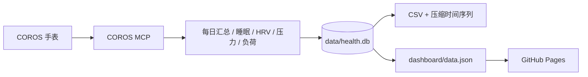

<div align="center">


# zhubao315 的健康数据

**睡眠、HRV、静息心率、压力、步数与训练负荷 —— 全部落成可查询的数据。**

[](https://github.com/zhubao315/health/actions/workflows/health_sync.yml)
[](https://zhubao315.github.io/health/)
[](https://github.com/zhubao315/health/tree/main/data)
[](https://github.com/zhubao315/health/commits)
[](https://github.com/zhubao315/health/blob/main/LICENSE)

[📊 在线面板](https://zhubao315.github.io/health/) · [🧠 分析指南](analysis/README.md) · [🔄 自动同步](#自动同步) · [🗂 数据字典](#数据字典) · [🔗 运动站点](#运动站点)

</div>

---

## 这是什么

一个纯数据仓库：每天从 **COROS 官方 MCP** 同步手表记录的健康数据，落成 SQLite + CSV + 压缩时间序列，并提供：

- 一个可直接看的 **健康趋势面板**（睡眠结构、HRV、静息心率、压力、步数、训练负荷、相关性）
- 一个 **SQL / Python 分析入口**，不用再手动导出表格
- 每天 **08:00（北京时间）** 自动更新，历史数据持续累积

## 数据覆盖

<!-- STATS:START -->
| 数据表 | 行数 | 开始 | 结束 |
| --- | ---: | --- | --- |
| 每日健康汇总 | 1,023 | 2023-12-30 | 2026-10-26 |
| 睡眠 | 1,027 | 2024-01-01 | 2026-10-26 |
| HRV | 1,011 | 2024-01-01 | 2026-10-26 |
| 日均心率 | 1,021 | 2024-01-01 | 2026-10-26 |
| 静息心率 | 1,020 | 2024-01-01 | 2026-10-26 |
| 压力（日） | 365 | 2025-10-27 | 2026-10-26 |
| 训练负荷 | 1,030 | 2024-01-01 | 2026-10-26 |
| 运动记录 | 3,257 | 2024-01-02 | 2026-10-26 |
<!-- STATS:END -->

> 最新数据：**2026-10-26** · 每天早上 08:00（北京时间）自动同步。

## 面板内容

- **KPI**：最近睡眠、睡眠分、HRV、基线、静息心率、压力、负荷比、恢复、VO2max、步数
- **睡眠结构**：深睡 / 浅睡 / REM / 清醒的每日堆叠图
- **HRV**：夜间 HRV 与个人基线
- **静息心率 / 压力 / 步数**：按 30 天、90 天、1 年、全部切换
- **训练负荷**：短期负荷、长期负荷与负荷比
- **相关性**：睡眠→次日 HRV、负荷→次日静息心率、压力→睡眠、步数→睡眠
- 所有图表都由 `dashboard/data.json` 驱动，数据口径与 CSV/SQLite 完全一致

## 自动同步



- **调度**：每天 `00:00 UTC` / `08:00 Asia/Shanghai`
- **增量**：每次回看 7 天，自动补齐漏跑
- **历史**：完整回填到 2023-12-30（COROS 健康数据起点）
- **工作流**：[`health_sync.yml`](.github/workflows/health_sync.yml)
- **无需服务器**：数据与面板都在仓库里，Pages 直接部署

## 数据字典

| 文件 / 表 | 内容 |
| --- | --- |
| `data/daily.csv` | 每日总表：步数、卡路里、运动分钟、压力、睡眠时长/分数、深睡/浅睡/REM/清醒、睡眠心率、HRV、静息心率、日均心率、训练负荷 |
| `data/daily_health.csv` | MCP 每日健康原始汇总 |
| `data/sleep.csv` | 睡眠分数、主睡眠时长、各阶段占比、清醒时长/次数、睡眠窗口、午睡 |
| `data/hrv.csv` | 夜间 HRV 平均值、正常区间、基线、评估状态 |
| `data/avg_hr.csv` | 日均心率 + 当日最低/最高 |
| `data/rhr.csv` | 每日静息心率 |
| `data/stress_daily.csv` | 日平均压力 + 放松/低/中/高压力时长 |
| `data/load.csv` | 短期负荷、长期负荷、负荷比、COROS 评语 |
| `data/activities.csv` | 所有运动记录（运动类型、距离、时长、均心率、卡路里） |
| `data/hrv_series.csv.gz` | 睡眠期间原始 HRV 点（约 2 分钟一个点，最近 90 天；之后每天累积） |
| `data/stress_series.csv.gz` | 原始压力序列（约 5 分钟一个点，最近 90 天；之后每天累积） |
| `data/health.db` | 以上数据的 SQLite 版本，带 `daily` 视图 |
| `dashboard/data.json` | 面板数据（由 DB 生成） |

## 能用它做什么分析

- 睡眠时长/深睡比例与次日 HRV、静息心率的关系
- 训练负荷（短期/长期/负荷比）与恢复、RHR 的滞后关系
- 压力、步数、运动分钟对睡眠的影响
- 月度/季度趋势：睡眠债、HRV 基线漂移、RHR 长期变化
- 原始压力/HRV 序列：日内节律、夜间恢复质量、异常日定位

示例 SQL 见 [`analysis/queries.sql`](analysis/queries.sql)，自动摘要见 [`analysis/summary.md`](analysis/summary.md)。直接查 SQLite：

```bash
sqlite3 data/health.db
sqlite> SELECT date, sleep_total_min, hrv_avg, rhr FROM daily ORDER BY date DESC LIMIT 10;
```

Python：

```python
import sqlite3, pandas as pd
df = pd.read_sql("SELECT * FROM daily ORDER BY date", sqlite3.connect("data/health.db"))
df["sleep_h"] = df.sleep_total_min / 60
df[["sleep_h", "hrv_avg", "rhr", "stress_avg"]].corr()
```

## 数据边界

MCP 能拿到的是 COROS 云端已经聚合/存储的数据，因此：

- ✅ 有：睡眠分期、睡眠 HR、HRV（日评估 + 原始点）、静息心率、日均心率、压力（日 + 原始点）、步数、卡路里、运动分钟、训练负荷、恢复、VO2max、设备信息
- ⚠️ 部分：VO2max / 恢复 / 设备是**当前快照**，历史趋势从本仓库开始每天累积
- ⚠️ 部分：原始压力/HRV 序列从最近 90 天开始，历史每日聚合是全量；之后每天增量累积
- ⚠️ 部分：压力区间时长只回填了最近 365 天，日均压力是全量
- ⚠️ 部分：血氧/呼吸率只存在于「健康检查」时间序列；本账号目前没有健康检查记录
- ❌ 没有：全天连续心率曲线、体温、睡眠呼吸暂停等 MCP 未开放的数据

## 本地运行

```bash
# 同步最近 7 天（需要 COROS 账号）
export COROS_ACCOUNT="..."
export COROS_PASSWORD="..."
python -m coros_health.cli --incremental

# 全量回填（首次）
python -m coros_health.cli --start 2024-01-01

# 生成分析摘要
python analysis/health_analysis.py --days 30

# 本地看面板
python -m http.server 8000 --directory dashboard
```

## 运动站点

| 站点 | 内容 |
| --- | --- |
| 🏃 [跑步](https://zhubao315.github.io/running/) | 跑步记录、热力图、3D 地形 |
| 🚴 [骑行](https://zhubao315.github.io/cycling/) | 骑行记录、均速、爬升 |
| 🥾 [徒步](https://zhubao315.github.io/hiking/) | 徒步、爬升、3D 地形 |

## 技术栈

Python 标准库 · COROS MCP（OAuth 2.0 + PKCE）· SQLite · Chart.js · GitHub Pages

## License

MIT
